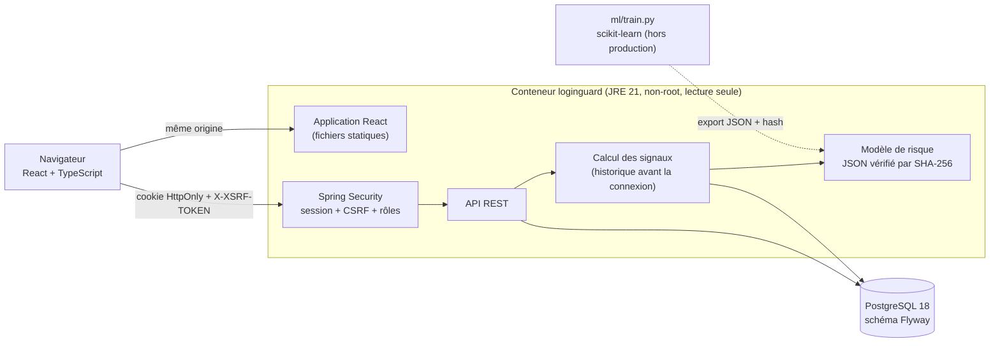

# LoginGuard

[](https://github.com/omarsaidiA/loginguard-risk-ml/actions/workflows/ci.yml)


Application web de **détection de connexions suspectes** (prise de compte, *account takeover*) :
chaque connexion enregistrée reçoit un **score de risque calculé par un modèle de machine learning
explicable**, et des analystes valident ou rejettent les alertes.

Backend Java / Spring Boot, frontend React / TypeScript, base PostgreSQL, modèle entraîné en Python et
exécuté en Java, pipeline DevSecOps complet.

## Fonctionnalités

- **Tableau de bord** : volumes par niveau de risque, file des alertes HIGH en attente de revue.
- **Événements de connexion** : enregistrement, score immédiat, filtres par risque et statut, pagination.
- **Explication de chaque score** : contribution de chaque signal (échecs récents, nouvel appareil,
  nouveau pays, « voyage impossible », heure, inactivité), affichée en barres.
- **Revue humaine** : « fraude confirmée » ou « légitime », avec l'analyste et la date enregistrés.
- **CRUD** des utilisateurs surveillés et des comptes opérateurs (administrateurs uniquement).
- **Fiche du modèle** : version, poids, seuils, métriques de test, avertissement sur les données synthétiques.

## Architecture



## Le modèle de prédiction

Une **régression logistique** entraînée par [`ml/train.py`](ml/train.py) puis exportée en JSON. Le
backend recalcule le score lui-même (standardisation, somme pondérée, sigmoïde) :
- **aucune bibliothèque de ML en production**, donc aucune dépendance de plus à surveiller ;
- **chaque score se décompose exactement** en contributions par signal : l'analyste voit pourquoi.

Les données d'entraînement sont **synthétiques**, et c'est écrit partout (fiche du modèle, interface) :
le projet démontre la chaîne complète, pas une précision réelle. Détails, métriques et limites dans
[`ml/README.md`](ml/README.md).

## Sécurité

| Sujet | Mesure |
|---|---|
| Authentification | Session dans un cookie `HttpOnly`, `SameSite=Strict`, `Secure` ; aucun token accessible au JavaScript (une XSS ne peut pas voler la session) |
| CSRF | Jeton dans un cookie lisible par l'app et renvoyé dans `X-XSRF-TOKEN` ; la connexion elle-même est protégée |
| Fixation de session | Identifiant de session régénéré à la connexion |
| Force brute | Verrouillage du compte après 5 échecs (15 min) **et** limite par IP (Bucket4j) contre le *password spraying* |
| Énumération de comptes | Même réponse pour utilisateur inconnu, mauvais mot de passe ou compte verrouillé ; comparaison BCrypt faite dans tous les cas (temps de réponse identique) |
| Mots de passe | BCrypt coût 12, 12 à 72 caractères, jamais renvoyés ni journalisés |
| Autorisations | Rôles ADMIN / ANALYST avec `@PreAuthorize`, plus une règle au niveau URL ; l'analyste d'une revue est toujours l'utilisateur connecté, jamais une valeur envoyée par le client |
| Entrées | Bean Validation stricte ; adresses IP **littérales** uniquement, sans résolution DNS ; contraintes `CHECK` en base en défense en profondeur |
| Erreurs | Problem details RFC 9457, sans stack trace, nom de classe ni SQL |
| En-têtes | CSP stricte (`script-src 'self'`, aucun inline), HSTS, `X-Frame-Options: DENY`, `nosniff`, `Referrer-Policy`, `Permissions-Policy` |
| Audit | Journal `SECURITY` (connexions, verrouillages, revues, suppressions) protégé contre l'injection de logs |
| Intégrité du modèle | SHA-256 du fichier vérifié au démarrage : un modèle modifié (par exemple un poids mis à zéro pour ne plus détecter les nouveaux appareils) empêche l'application de démarrer |
| Conteneur | Multi-stage, JRE seul, utilisateur non-root, système de fichiers en lecture seule, aucune capability, base non exposée |
| Chaîne d'approvisionnement | Versions exactes partout (lockfile npm, requirements figés), `npm ci --ignore-scripts`, actions épinglées par SHA, Dependabot avec *cooldown* |

### Trouvé et corrigé pendant le développement

- **Empoisonnement de l'historique** : à l'origine, les tentatives échouées comptaient dans
  l'historique. Un attaquant qui échouait quelques fois depuis sa machine rendait son appareil et son
  pays « connus » avant d'utiliser le mot de passe volé : le scénario de prise de compte sortait
  MEDIUM au lieu de HIGH. Les signaux se basent désormais sur les **connexions réussies uniquement**,
  avec un test de non-régression.
- **Cookie CSRF sans `SameSite`** : repéré en lançant mon outil
  [headercheck](https://github.com/omarsaidiA/headerchecker) contre l'application ; il reçoit
  maintenant les mêmes attributs que le cookie de session.

## Démarrage

Prérequis : Docker avec Compose.

```bash
cp .env.example .env          # puis remplacer les deux valeurs (openssl rand -base64 24)
docker compose up -d --build --wait
set -a; . ./.env; set +a
bash scripts/seed-demo.sh     # utilisateurs, trois semaines de connexions, deux attaques
```

Ouvrir http://localhost:8080 et se connecter avec `admin` et le mot de passe `LOGINGUARD_ADMIN_PASSWORD`.
L'administrateur peut ensuite créer des comptes ANALYST dans **Operators**.

## Pipeline CI

| Job | Contenu |
|---|---|
| Backend | 59 tests sur un vrai PostgreSQL (Testcontainers) : API, sécurité, verrouillage, rate limiting, CSRF, scoring, intégrité du modèle |
| Frontend | Typage strict, tests (jeton CSRF, erreurs, rendu sans XSS), build |
| Modèle | Réentraînement et comparaison avec le modèle versionné, vérification du SHA-256 épinglé |
| Secrets | Gitleaks sur tout l'historique |
| SAST | Semgrep : Java, TypeScript/React, Python, Dockerfile, workflows, OWASP Top 10 |
| SCA | Trivy sur les dépendances Maven, npm et pip |
| Conteneur | Scan Trivy de l'image, puis lancement de la stack, données de démonstration via l'API (échec si l'attaque n'est pas HIGH), audit des en-têtes avec headercheck |

Tous les rapports arrivent en SARIF dans l'onglet **Security** du dépôt.

## Développement

```bash
cd backend && ./mvnw verify                 # JDK 21 et Docker (Testcontainers)
cd frontend && npm ci && npm run dev        # http://localhost:5173, API proxifiée vers 8080
```

## Licence

[MIT](LICENSE)
